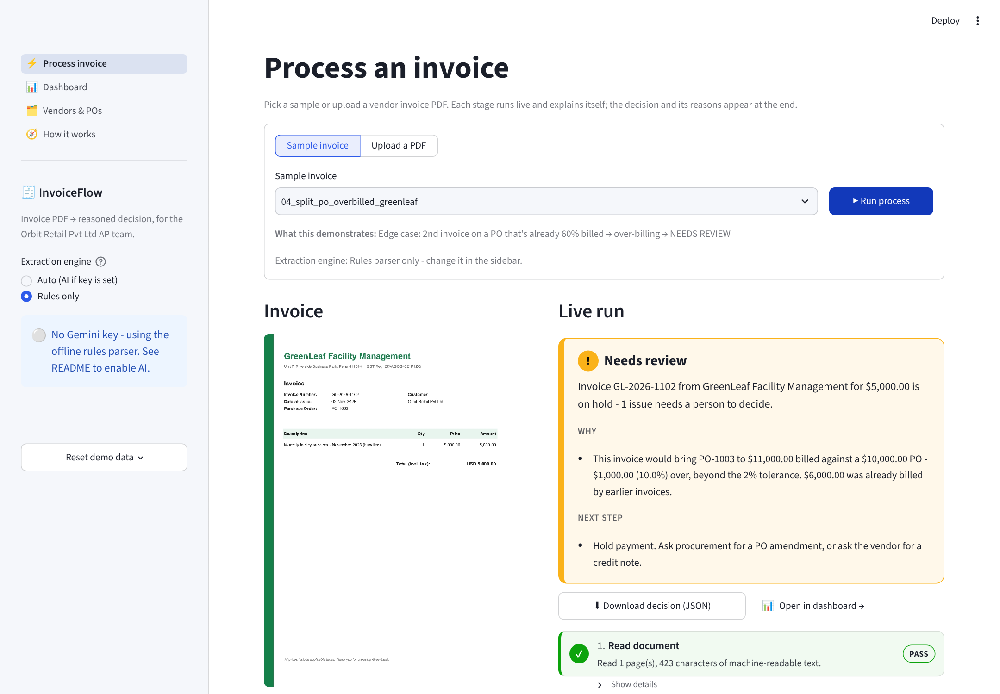
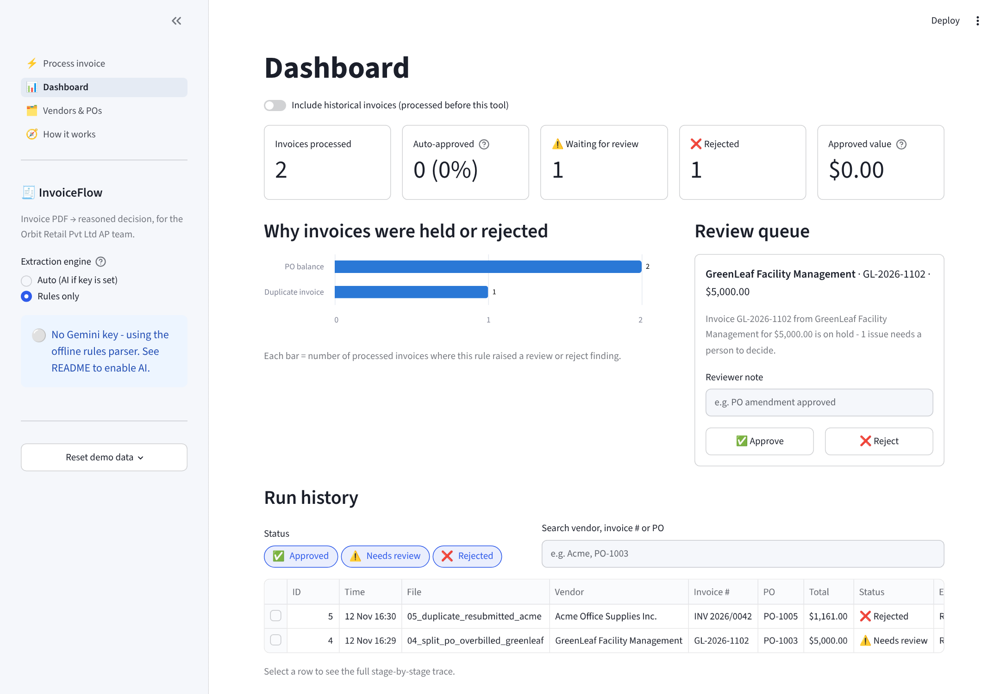
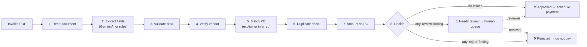

# InvoiceFlow: invoice PDF → reasoned AP decision

**AI Solutions Analyst take-home case study · PS-1 (Finance / AP): Invoice processing**

> 🔗 **Live app:** `<PASTE-YOUR-STREAMLIT-URL-HERE>` · 🎥 **Demo video:** `<PASTE-VIDEO-URL-HERE>`
> *(Free apps sleep when idle. If the page asks, click "Yes, get this app back up!" and wait about 30 seconds.)*

InvoiceFlow takes a vendor invoice PDF and decides what the Accounts Payable team should do with it:
**Approved**, **Needs review** or **Rejected**. It shows every step it took and why.

It does what an AP clerk does by hand:

1. Opens the invoice.
2. Finds the purchase order (PO).
3. Checks that the vendor is approved and that the numbers line up.
4. Makes sure the invoice hasn't already been paid.
5. Makes a decision.

Every stage is shown live as it runs. A dashboard keeps the history, and a review queue lets a person decide the invoices the process wasn't sure about.

> **How it is built:**
> - **AI reads the invoice.** Google Gemini handles messy layouts and scanned images.
> - **Rules make the decision.** The checks are deterministic, so they are explainable and auditable.
> - **It works offline.** Without an API key, a built-in rules parser does the extraction, so the demo never breaks.

---

## 1. Quick start (about 3 minutes)

You need Python **3.10–3.13**.

```bash
cd invoice-ap-automation
python -m venv .venv
source .venv/bin/activate          # Windows: .venv\Scripts\activate
pip install -r requirements.txt
streamlit run app.py
```

The app opens at **http://localhost:8501**. Pick a sample invoice and press **▶ Run process**.

It works immediately **without any API key**, using the offline rules parser.

### Turn on AI extraction (optional, free)

1. Get a free Gemini API key at **https://aistudio.google.com/apikey**. A Google account is enough; no card is needed.
2. Copy `.streamlit/secrets.toml.example` to `.streamlit/secrets.toml` and paste in your key:
   ```toml
   GEMINI_API_KEY = "your-key"
   ```
   Or set an environment variable: `export GEMINI_API_KEY=your-key`.
3. Restart the app. The sidebar should show **"Gemini key found"**.

The default model is `gemini-flash-latest`, Google's alias for the current Flash model. If Google renames it, set `GEMINI_MODEL` in the same file, using a model name listed in AI Studio.

If the AI call fails for any reason (no internet, quota, wrong key), the process **automatically falls back to the rules parser** and says so on screen.

---

## 2. What you'll see





| Page | What it shows |
|---|---|
| ⚡ **Process invoice** | Pick a sample or upload a PDF. **Live run view:** the 8 stages light up one by one (pass ✓ / note ! / issue ✕ / skipped). The decision card shows *why* and the *next step*. You can download the full decision as JSON. |
| 📊 **Dashboard** | KPIs (processed, auto-approval rate, waiting for review, rejected, approved value), a chart of the rules that cause holds and rejections, the **review queue** (approve or reject with a note), and the run history. Click any run to replay its full stage-by-stage trace. |
| 🗂️ **Vendors & POs** | The reference data every invoice is checked against: the vendor master, the PO register with live "billed to date" balances, and the invoice ledger. |
| 🧭 **How it works** | The process map, every rule in a table, why AI is used where it is, and the assumptions. |

**Sidebar:**
- Switch between **Auto (AI)** and **Rules only** extraction.
- **Reset demo data** restores the starting state. Do this before every demo.

---

## 3. The process



Each stage produces **findings**, and each finding has one of four outcomes:
- `pass`
- `warn`: approved, but with a note
- `review`: a person must decide
- `reject`: must not be paid

**Decision rule:** any *reject* → **Rejected**; otherwise any *review* → **Needs review**; otherwise → **Approved**.

### Rules

All thresholds live in `core/config.py`.

| # | Stage | Rule | If it fails |
|---|---|---|---|
| 1 | Read document | The PDF must have a text layer, or AI must be on to read the scan | Needs review (manual entry) |
| 2 | Extract fields | Values extracted by AI must appear in the PDF text (anti-hallucination check) | Needs review |
| 3 | Validate data | Vendor, invoice #, date and total must be present; the date can't be in the future | Needs review |
| 3 | Validate data | Line items + tax = total (±$1) | Needs review |
| 4 | Verify vendor | The vendor must be in the vendor master (≥85% fuzzy name match) and **active** | **Rejected** |
| 5 | Match PO | The quoted PO must exist, belong to *this* vendor, and be open | Needs review |
| 5 | Match PO | No PO on the invoice → infer it: exactly **one** open PO of this vendor must fit the amount | Needs review if 0 or 2+ fit |
| 6 | Duplicate check | Same vendor + same invoice # after normalising (`INV 2026/0042` = `INV-2026-0042`) | **Rejected** |
| 6 | Duplicate check | Same vendor + same amount + same date, but a different invoice # | Needs review |
| 7 | Amount vs PO | The invoice must fit the PO's **remaining** balance (PO amount − earlier approved invoices); up to **2%** over is tolerated | Needs review |
| 7 | Amount vs PO | Invoices above **$25,000** always need a human approver | Needs review |

---

## 4. Demo scenarios: the edge cases

All the sample PDFs are in `sample_invoices/`. Three vendors use three **different layouts**: different labels, tax shown separately vs. included, and PO quoted vs. missing. This mirrors a real AP inbox.

| File | Scenario | Result |
|---|---|---|
| `01_happy_path_acme` | Explicit PO-1001, amounts match exactly | ✅ Approved |
| `02_close_match_brightpath` | A different layout ("Bill #", "Your Ref"); total is **1.5% above** the PO | ✅ Approved, with a tolerance note |
| `03_no_po_reference_nimbus` | ⭐ **Edge case 1, implied PO:** no PO number on the invoice. The process infers PO-1004 (the vendor's only open PO with enough balance; the closed PO is ignored) | ✅ Approved, with an "inferred" note |
| `04_split_po_overbilled_greenleaf` | ⭐ **Edge case 2, split billing:** the second invoice on PO-1003. $6,000 is already billed, and this $5,000 invoice takes it to $11,000 against a $10,000 PO (10% over) | ⚠️ Needs review |
| `05_duplicate_resubmitted_acme` | ⭐ **Edge case 3, disguised duplicate:** an already-paid invoice is re-sent as a "reminder" with the number written `INV 2026/0042` instead of `INV-2026-0042` | ❌ Rejected |
| `06_scanned_brightpath` | ⭐ **Edge case 4, scanned invoice:** an image only, with no text | Rules only: ⚠️ Needs review (the process does not guess). With AI: Gemini reads the scan → ✅ Approved |
| `07_unknown_vendor` | The vendor isn't in the vendor master **and** quotes another vendor's PO | ❌ Rejected |
| `08_missing_fields_greenleaf` | No invoice number and no date | ⚠️ Needs review |

**Live bonus:** run `01` (approved), then run `01` again. It is **rejected as a duplicate** of the one you just approved.

Why these edge cases matter:

- **Implied PO:** many real invoices don't quote a PO. A process that rejects all of them creates more manual work than it saves. Inference is only safe when there is **exactly one** candidate. If there are two, the process asks a human.
- **Split billing:** vendors often bill one PO in several invoices. Checking each invoice against the full PO amount would miss over-billing. The process checks against the **remaining** balance, using the ledger of earlier invoices.
- **Disguised duplicate:** paying the same invoice twice is the most common and most expensive AP error. Exact text matching misses `INV 2026/0042` vs `INV-2026-0042`, so the process normalises invoice numbers before comparing them.
- **Scanned invoice:** if the process can't read an invoice, it **routes it to a human instead of guessing**. With AI enabled, it can read scans.

---

## 5. Design decisions

1. **AI for reading, rules for deciding.**
   - Reading varied layouts is a language task, and that is what AI is good at.
   - Deciding whether to pay must be predictable, so the rules are deterministic. The same invoice always gets the same answer, and every decision has a written reason.
2. **Never guess.**
   - The AI prompt says to return `null` for anything missing.
   - Missing data → Needs review.
   - Values extracted by AI are cross-checked against the PDF text, and the arithmetic check catches misread numbers.
3. **Three outcomes, not two.** "Needs review" keeps humans in the loop for genuine judgement calls. Only clear-cut failures are rejected outright: an unknown or blocked vendor, or a duplicate.
4. **Graceful degradation.**
   - With no API key, no internet, or an AI error, the process falls back to the rules parser.
   - If a document is unreadable, the process stops early and routes the invoice to a person.
5. **Every rule threshold lives in one file** (`core/config.py`), so an AP manager's policy can change without touching the logic.
6. **Full audit trail.** Every run stores the complete stage-by-stage trace, so you can always answer "why was this approved?" later.

## 6. Assumptions

- The PO amount is the total approved spend **including tax**. Matching is done on the invoice total, not line by line.
- There is one currency (USD). Numeric dates like `05/11/2026` are read as day/month/year.
- Only **approved** invoices count towards a PO's billed amount. Any invoice that wasn't rejected counts for duplicate detection.
- The vendor master, PO register and invoice history are CSV files (`data/`) standing in for an ERP or procurement system.
- Invoices arrive as PDFs. Email intake is out of scope; the upload stands in for the email inbox.

## 7. Limitations and what I'd build next

| Today (POC) | Next step |
|---|---|
| Matches the invoice total to the PO | Line-level and **3-way match** (PO ↔ goods receipt ↔ invoice) |
| PDFs are uploaded by hand | Read the AP mailbox automatically (Gmail / Outlook API) |
| CSV reference data | Connect to the ERP (NetSuite, SAP, Tally) |
| One currency, one company | Multi-currency with FX rates, multiple entities |
| A reviewer approves in the app | Send the review task to Slack or email, and auto-draft the vendor email for missing information |
| Only one reviewer level | Approval routing by amount and department; SLA tracking |
| SQLite, single user | Postgres, user logins and roles |

---

## 8. Project structure

```
invoice-ap-automation/
├── app.py                  # Streamlit entry point: navigation + sidebar
├── views/
│   ├── process.py          # Process invoice page (live run view)
│   ├── dashboard.py        # KPIs, exception chart, review queue, history, run detail
│   ├── reference.py        # Vendor master, PO register, invoice ledger
│   └── how_it_works.py     # Process map, rules, assumptions
├── core/
│   ├── config.py           # ALL business thresholds + API key loading
│   ├── extract.py          # PDF reading, Gemini extraction, regex fallback
│   ├── rules.py            # The business rules (one function per stage)
│   ├── pipeline.py         # Runs the stages in order and makes the decision
│   ├── db.py               # CSV reference data + SQLite invoice ledger
│   └── ui.py               # Stage cards and decision card (shared UI)
├── data/                   # vendors.csv, purchase_orders.csv, invoice_history.csv
├── sample_invoices/        # 8 test PDFs (see section 4)
├── scripts/generate_sample_invoices.py   # recreates the sample PDFs
├── tests/test_pipeline.py  # automated tests for every scenario
└── assets/                 # screenshots used in this README
```

## 9. Tests

```bash
pytest -q
```

There are 21 tests. They check:
- every sample → expected decision;
- re-running an approved invoice → duplicate;
- a reviewer approval updates the PO balance;
- PO inference is ambiguous when two POs fit;
- a closed PO is refused;
- a possible duplicate is flagged when the amount and date match;
- invoices over the approval limit go to review;
- AI failure → rules fallback;
- AI reads the scanned invoice;
- an AI value not printed on the PDF → review.

The tests mock the Gemini call, so they need no API key or internet.

To recreate the sample PDFs: `python scripts/generate_sample_invoices.py`

## 10. Deploy a live link (Streamlit Community Cloud, free)

1. Push this folder to a **GitHub** repository. Make sure `.streamlit/secrets.toml` is **not** committed; it is already in `.gitignore`.
2. Go to **https://share.streamlit.io** → *Create app* → pick the repo and branch, and set the main file to `app.py`.
3. Under *Advanced settings*:
   - Choose Python 3.12.
   - Under *Secrets*, paste `GEMINI_API_KEY = "your-key"`.
4. Click *Deploy*. You'll get a URL like `https://your-app.streamlit.app`. That's the "live and runnable" link to submit.

Notes:
- Free apps go to sleep after a period of no use. **Open the link a few minutes before your interview** to wake it up.
- The demo database resets when the app restarts. Use **Reset demo data** before demos anyway.
